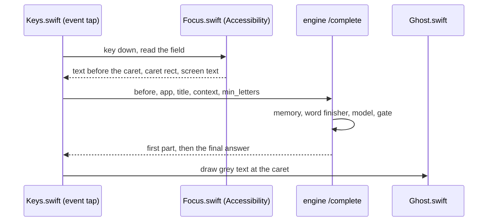

# Architecture

Drafter is a macOS writing helper. It shows grey text at the caret in any app, takes dictation on Right Option (once on: menu, Voice on Right Option) and
records calls and long notes. Everything it needs runs on your Mac. This page shows the parts and how they talk.

## Three processes

| Process | Code | What it owns |
|---|---|---|
| Menu-bar app (Swift) | `app/` | Keys, Accessibility reads and writes, the grey text panel, the notch strip, the window, the microphone, call capture, settings |
| Text engine (Python) | `engine/server.py` | One warm text model, the gate, phrase memory, word finisher, chips, the cloud helpers when you connect a model and turn them on |
| Voice process (Python) | `engine/voice.py` | One speech model at a time (Parakeet or Whisper), takes and whole recordings |

The app starts both Python processes and restarts them when they stop. They exit when the app is gone.

- All Swift files in `app/` build into one binary with `app/build.sh`. The `Engine` class in `app/Engine.swift` runs
  the text engine. `app/Voice.swift` runs the voice process.
- The text engine is an HTTP server on `127.0.0.1:8798`. It answers local programs only. A request with an
  `Origin` or `Sec-Fetch-*` header, another `Host`, or a POST that is not JSON gets 403, so a web page cannot use it.
  Every route but `/health` also needs the per-launch token: the app writes it to `data/engine.token` (mode 0600)
  and sends it as `X-Drafter-Token`.
- The voice process has no port. The app writes audio frames to its stdin and reads JSON lines from its stdout.
  The frame kinds are listed at the top of `engine/voice.py`.
- Both models sleep when unused, so an idle Drafter holds little memory. The text model unloads after
  `textIdleMin` minutes without typing (30; 0 = never; a Settings switch) and loads again when a text field gets
  focus. The voice reader is dropped after `voiceIdleMin` minutes without a take (30; config-only, in
  `data/settings.json`).
- The clipboard picker (`app/Quick.swift`, ranking rules in `app/QuickRules.swift`) lives in the app. They read the clipboard, typed and voice histories from `data/` and never call the engine except for a
  rework.
- Each Python process runs a memory guard (`engine/guard.py`). It stops the process above a cap: 3.6 GB for the
  text engine (`DRAFTER_CAP_GB`) and 2.8 GB for the voice process (`DRAFTER_VOICE_CAP_GB`).

## From a key press to grey text

1. `Keys.handle` in `app/Keys.swift` sees every key through a CGEvent tap. Tab, Right Option and a few other keys
   belong to Drafter. Every other key goes on to the app.
2. `Keys.predict` asks at once for the text the field will hold after this key. `Keys.ask` asks again after the
   app has put the letter in.
3. `Focus.spot` in `app/Focus.swift` reads the focused field: the text before the caret, the caret position, the
   window title. `Focus.screenContext` reads the text above the field, such as the message you answer. When
   Accessibility gives almost nothing, `app/Screen.swift` reads that part of the screen with on-device OCR.
4. The app posts to /complete. `engine/server.py` tries the instant sources first, then the model, and the
   gate decides whether to show anything. With `"stream": true` the first words come back as a part.
5. `Ghost.show` in `app/Ghost.swift` draws the grey text in the field's own font. A later part only adds words at
   the end (`Ghost.extend`). [Typing](typing.md) explains each step.

Pure rules sit in their own files with no AppKit, so a test can check them alone. Examples are
`app/GhostRules.swift`, `app/CaptureRules.swift` and `app/CorrectionRules.swift`.

## Where state lives

All state lives in `data/` in the repo folder. It is never tracked by git. `DRAFTER_DATA` moves it elsewhere:
the app reads it (or `DrafterData` in its `Info.plist`, from `build.data_dir` in the local config) and passes it to
the engine and the voice process; `engine/data_dir.py` gives the engine and the scripts the same answer. Training,
the nightly job and the bench scripts write `data/` in the clone, so `DRAFTER_DATA=<folder> scripts/setup.sh` makes
`data/` a link to that folder (`scripts/link_data.sh`, which never moves a file): then everything uses one folder.
With no `DRAFTER_DATA` and no `data/` in a clone the app cannot write to, it uses
`~/Library/Application Support/Drafter`.
Paths below are written as `data/`.

- `data/drafter.local.json` is your local config: your name for the prompts, your languages and which
  optional integrations are on. `drafter.local.example.json` shows every key. `engine/local.py` reads it for the
  engine and `app/LocalConfig.swift` for the app. `.venv/bin/python engine/local.py` prints what is in effect.
  With no file, the prompts say "the user" and every integration is off.
- `data/settings.json` holds the app's switches, including the clipboard picker keys and limits (`quickKey`,
  `quickMax`, `quickDays`, `quickSecret`, `switchKey`, `switchFormat`) and the idle sleep (`textIdleMin`,
  `voiceIdleMin`). The app writes it. The engine reads it and notices when it changes. Keys with no row in Settings
  (config-only, the `hidden` list in `app/SettingsRules.swift`) include `quickMax`, `quickSecret`, `switchFormat` and
  `voiceIdleMin`.
- `data/words.json` is your dictionary: names, projects and words the model and the voice reader should know.
  `engine/dictionary.py` creates it from `dictionary/words.example.json` on a new install.
- Typed lines, takes, recordings, notes and logs are listed in [Privacy](privacy.md).

## Building and packaging

- `app/build.sh` builds `~/Applications/Drafter.app` and never opens it. `DRAFTER_APP_OUT` builds elsewhere.
  It signs ad-hoc with a fixed requirement, so macOS keeps the permissions across rebuilds; a Developer ID in
  `DRAFTER_CODESIGN_IDENTITY` (or `build.codesign_identity`) signs with the hardened runtime instead.
- `scripts/package_app.sh` builds Drafter.app and Drafter-macos-arm64.zip in build/dist (not in git) for teammates
  without Command Line Tools, and notarizes it when `DRAFTER_NOTARY_PROFILE` names a notarytool profile.
- `scripts/setup.sh` installs `requirements-lock.txt` as it is. `scripts/check_lock.sh` is for maintainers: it
  resolves `requirements.txt` again and says when the lock is out of date.

## The nightly job

`bench/nightly.sh` runs once a night from a launchd job. In order, it:

1. Rotates logs (`scripts/rotate_logs.py`).
2. Compares the SQLite journal (`data/journal.sqlite`) with the JSON lines files, numbers only
   (`scripts/journal_compare.py`).
3. Moves recording audio and video older than 14 days to the Trash, when a transcript is there
   (`scripts/prune_audio.py`; [Privacy](privacy.md) has the conditions).
4. Builds your writing into one dated corpus (`bench/corpus.py`).
5. Rebuilds the knowledge pack (`engine/know.py`) and the names reference (`engine/names.py`).
6. Rebuilds the typo fix tables (`engine/typos.py`).
7. Writes a review of yesterday's suggestions and takes (`bench/review.py`).
8. Runs the weekly retrain when it is due (`bench/retrain.py`). It needs the Mac on power and idle for 10 minutes.
9. On Fridays, writes the weekly page (`bench/week.py`).

[Training](training.md) explains the retrain.

## Where to read next

- [Typing](typing.md): the sources of a suggestion, the gate and Tab.
- [Training](training.md): the personal layer and how to train it on your writing.
- [Voice and calls](voice-and-calls.md): takes, the strip and recordings.
- [Privacy](privacy.md): what may leave the Mac and what is stored.
- [Look](look.md), [Building with agents](building-with-agents.md), [Contributing](contributing.md).
