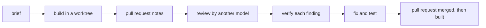

# Building with agents

Most of Drafter was built by coding agents, with one lead that briefs, checks and merges. This page describes that
way of working and two mistakes worth learning from.

## Tracks and roles

Four saved roles in `.claude/agents/` each own one track and its files.

| Role | Track | Owns, for example |
|---|---|---|
| `drafter-typing` | Grey text speed and accuracy | `engine/model.py`, `engine/gatecore.py`, `engine/words.py`, `bench/`, `app/Keys.swift` |
| `drafter-voice` | Takes, the strip's logic, calls, transcripts | `engine/voice.py`, `app/Voice.swift`, `app/Call.swift` |
| `drafter-look` | Window, chips, strip drawing, marks, previews | `app/Look.swift`, `app/Window.swift`, `app/Preview.swift` |
| `drafter-quality` | Tests, the replay, review findings, dead code | `tests/`, `bench/review.py`, `bench/week.py` |

Each role file states a goal that never changes. For typing it is: first grey text sooner, and the first word right
more often. Every role file ends with the same rules for all builders.

## Branches and who builds

- Each builder works on its own branch cut from main. When several run at once, each gets its own git worktree,
  `.worktrees/<name>`.
- Builders never run `app/build.sh` unless asked, and never start, stop or restart the app or its engines, because
  that replaces the app the person is using.
- Builders make small commits, push their branch to `origin` and open a pull request. Nobody force pushes.
- **A person merges.** Whoever merges builds from main, restarts the app and does the live checks.

This keeps one person responsible for what runs on each Mac. A builder cannot break the live app.

## How a round runs

1. **Brief.** The lead writes the goal, the files in scope, what is already rejected, and the numbers to report.
2. **Build.** The builder works in its worktree and runs the whole-app typecheck and each test file.
3. **Notes.** The builder writes notes in the pull request: what changed, what was measured, what was only read from code, and
   the manual check to do after a rebuild. It says plainly what it did not verify.
4. **Review.** A different model reads the round's commits and lists findings.
5. **Verify.** Each finding is checked against the code before anyone fixes it. The verdict is REAL, NOT REAL, or
   REAL BUT DIFFERENT. A real finding gets a failing test first, where one can be written.
6. **Merge.** A person merges the pull request, builds from main, restarts the app and does the live checks.

## Measure first

A typing change is kept only with numbers before and after, on the same held-out lines:

- first word right at first display;
- letters saved;
- wrong offers per 1,000 letters;
- time to the first grey text.

All typing benches score through one replay, `bench/measure.py`. Fitting uses the earlier half of the held-out
lines, by date, and the score uses the later half. Before this rule, a change could look good on the lines it
was tuned on. Settings that a bench cannot judge are listed as "believed, not measured" in the pull request.

Some ideas lost on numbers and were dropped: wider phrase memory, a bigger model, a layer trained on every source.
[Training](training.md) lists them.

## Two mistakes worth knowing

**Five rounds in one day.** Five agents each finished a round on the same day. Each passed its own tests. A later
outside review of those rounds listed 25 findings. When each was checked against the code, 20 needed a fix: data
races, a recording that could lose the other side, a ghost left on screen after its words changed, a fast double
Tab that put a word in twice. The lesson: parallel rounds need a review pass of their own before release, and
"tests pass" is not the same as "reviewed".

**A setting checked in the app but not in the engine.** The app checked the Claude switches before it sent a
request. Some engine routes did not check them again. One route started Claude workers on every field focus with
only one of its two switches checked. Another had no check at all. The fix was one table, `engine/cloud.py`,
that names the switch owning each feature that sends text to Claude, and one engine function,
`server.claude_on(feature)`, that checks it. `tests/test_cloud_gate.py` walks every Claude call site in `engine/`
and fails when one is missing from the table or skips the check. The lesson: a privacy rule belongs where the data
leaves, not only in the user interface.
