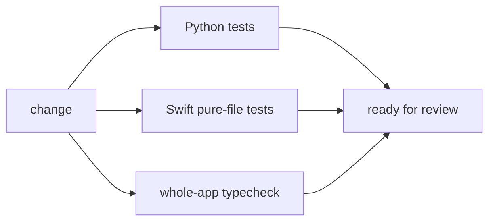

# Contributing

Thank you for helping. This page says how to run the tests and which rules a change must meet before it is merged.
[Architecture](architecture.md) is the best place to start reading the code.

## Run the tests

Run every test file in its own process. Some tests load native libraries or replace modules, and they can affect
each other inside one process.



### Python

```sh
zsh scripts/run_tests.sh
```

It runs each Python test file in `tests/` in its own process, prints the failures, and ends with a count such as
`N/N test files pass`. It exits 1 on any failure. To run one file, for example: `.venv/bin/python -B tests/test_cloud_gate.py`.

### Swift

Pure Swift files (rules with no AppKit) have their own Swift tests in `tests/`. The first lines of each test file
hold its exact `swiftc` command. For example, `tests/ghost_rules.swift` starts with:

```sh
swiftc -parse-as-library app/GhostRules.swift tests/ghost_rules.swift -o app/build/ghost-rules-test && app/build/ghost-rules-test
```

Then typecheck the whole app:

```sh
swiftc -typecheck -swift-version 5 -parse-as-library -target arm64-apple-macosx15.0 app/*.swift
```

Tests never need the app to run, never load a speech model and never read your `data/`.

## Rules a change must meet

### Numbers before and after for any typing change

A change to suggestions needs numbers from `bench/measure.py` before and after, on the same held-out lines:

1. first word right at first display;
2. letters saved;
3. wrong offers per 1,000 letters;
4. time to the first grey text.

Report them in the pull request. A change that only "feels faster" is not enough. [Typing](typing.md) describes
the replay.

### No private text in tracked files

Your own lines, takes, notes and chats live in `data/` and never go into code, tests, docs or commits. Tests use
made-up lines. Report numbers, never quotes.

`tests/test_no_private.py` checks every published file for home folder paths and real email addresses. It also
checks names from a deny-list you keep outside git (`data/public-deny.txt`, or the file named by `DRAFTER_DENY`).
Use `@example.com` addresses in examples. Use made-up names such as Marta, Sava, Mila or Alex.

### Every Claude call behind an owning switch

Any code that sends text to Claude must ask first with `server.claude_on(feature)`. The feature must have a row in
`OWNERS` in `engine/cloud.py`, which names the switch that owns it. New switches default to off in
`cloud.DEFAULTS` and in the app's settings. `tests/test_cloud_gate.py` fails on a call site that skips this.
`tests/test_cloud_defaults.py` checks that the app and the engine agree on the defaults. Then run
`python3 scripts/cloud_table.py --write` so the table in [Privacy](privacy.md) stays true.

### Tests type only into a marked field

A test that types or pastes must go only into a text field that holds the marker `⟦drafter-test⟧`. It must check
the marker when it starts and again right before it inserts. Without this check, a test can write into a field
you are using. Lines typed in a marked field are never learned.

### Never send a message

No code may press Send for you. An action may fill a draft box. You send it yourself.

### Optional integrations stay optional

A feature that needs another tool must ask `integrations.available(name)` (engine) or `LocalConfig.available`
(app) and stay quiet when the answer is no. A new install has every integration off. See
[Privacy](privacy.md).

## Before you open a pull request

- Python tests pass, Swift tests for the files you touched pass, and the whole-app typecheck is clean.
- Typing changes carry their before and after numbers.
- Visual changes carry preview renders from `zsh scripts/look-preview.sh <folder>` in both themes. See
  [Look](look.md).
- The description says what you did not verify, for example a check that needs a real call or a real
  microphone.
