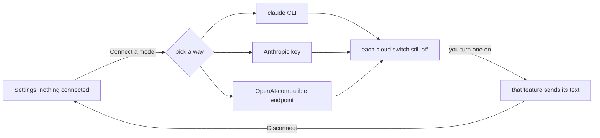
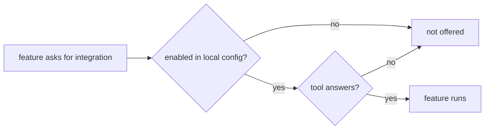

# Privacy

Drafter is local by default. With nothing connected, no text leaves your Mac: suggestions, voice and history stay
on it. One exception for Andrii's own setup: heavy background jobs may run on his own server (see "Your own server"). Sending text to a model outside the Mac is a choice you make, once, with "Connect a model".

## Connect a model

At the top of Settings, "Connect a model" offers three ways. You pick one from the list:

1. **Claude Code on this Mac**: your signed-in `claude` command-line tool.
2. **An Anthropic API key**: requests go to the Anthropic Messages API.
3. **An OpenAI-compatible endpoint**: a base URL, a key and a model name. Any other provider works, or a model
   server on your own Mac.

- A key is stored in the macOS Keychain. It is never written to `data/settings.json`, a log or a command line. The
  app hands it to the local engine's memory after each start (`app/Connect.swift`, `engine/provider.py`).
- Connecting turns nothing on. Every feature below keeps its own switch, off until you turn it on. Until you connect,
  those switches are shown but disabled.
- The Anthropic path uses `claude-haiku-5-5` for the fast helpers and `claude-sonnet-5-5` for rework.
  Both are settings (`connect.fastModel`, `connect.carefulModel` in `data/settings.json`).
- **Disconnect** turns every cloud switch off, removes the key from the Keychain and tells the engine to forget it.

## Your own server

Only when you turn on `integrations.server` in `data/drafter.local.json` (an ssh alias of a Linux box you control,
with Docker), these may go to that server, and nowhere else:

- **Training lines** for the weekly retrain, only with `retrainRemote` on (`bench/remote_train.py`).
- **Background jobs** from the queue in `bench/jobs.py`: call and long-note audio for a careful re-transcribe, and
  journal text for the search index.

Each run copies its inputs to a job folder, runs in a container, brings back only the result, and deletes the folder
and the container afterwards, on success and on failure. Nothing waits on the server: when it is down, jobs wait on the
Mac. With the integration off (the default) there is no server and none of this.

## What never leaves the Mac

- **Grey text.** The text model runs on your Mac. Keys, field text and screen text go only to the local engine on
  `127.0.0.1:8798`. That engine refuses requests from web pages.
- **Voice.** Takes, long notes and calls are read by local models first. Audio goes nowhere else, except a careful
  re-read on your own server (below).
- **Training.** The corpus, the personal layer and every bench run on your Mac, unless `retrainRemote` is on.
- **History.** Typed lines, drafts, takes, clipboard history, recordings, notes and logs stay in `data/`.
- **Screen video.** `callScreenVideo` is off by default. When enabled, local `screen.mp4` stays beside the call audio.
  Capture checks excluded apps, secure input, screen lock and display sleep before capture and before writing each frame.
  Paused calls add no video frames. Logs contain frame, skip and failure counts, never window titles or screen text.

Drafter never reads or writes password fields. It stops while secure input is on. It skips apps you mark with
"Skip this app". Clipboard history never keeps items that password managers mark as concealed, nor copies that
match the patterns in the `quickSecret` setting (API keys, card numbers, one-time codes by default). It keeps at most
`quickMax` rows (1000) and none older than `quickDays` (30 days; 0 = no age limit).

- **Quick panel and paste switcher.** The Quick panel (⌃⌥V, setting `quickKey`) lists what you copied, typed and said,
  and puts a row at your caret. The paste switcher (⌘⇧V, setting `switchKey`) cycles through recent copies. Both run
  on your Mac. Of the panel's rewrites, plain text, one line and quote are local; the rework list goes to a connected
  model only when `rework` is on, otherwise the local model writes it. Neither puts text into skipped apps, password
  fields or under secure input: there the text goes to the clipboard instead.

## What each feature sends

Each feature runs only when a model is connected and its switch is on. `engine/cloud.py` names the switch that owns
each one; the engine checks it (`server.claude_on`) before any text goes out, and `tests/test_cloud_gate.py` fails
when a call skips that check. The table is generated from `engine/cloud.py` by `scripts/cloud_table.py`.

What goes out, per feature:

- `rework`, `rewrite`: the selected text and the app name.
- `command`: the one line you typed in the command panel.
- `ask`: your spoken question and the snippets of your notes that match it.
- `call_notes`: the transcript text of the call or long note. The recording itself stays on the Mac.

<!-- cloud-table:start -->
| Feature | What it does | Settings switch that owns it (default) |
|---|---|---|
| `rework` | rework a selection (shorter, clearer, ...) with Option-Tab | `rework` (off) |
| `rewrite` | speak over a selection to rewrite it | `rework` (off) |
| `command` | the command panel line, after you pick it | none: runs only on your own action |
| `ask` | a spoken question to your own notes | none: runs only on your own action |
| `call_notes` | the live outline and the summary of a call or long note | `callNotes` (off) |
| `entities` | the kind of a name no source knows (the name only), when you run it | `entityClassify` (off) |
| `backoffice` | a nightly or on-demand batch: tags the day, cleans call notes, person cards, grades ghosts, the weekly review | `backOffice` (off) |
| `voice_claude` | a Clean or Polished voice take after it went in, with names and the screen text before it; Raw never | `voiceClaude` (off) |
| `pause_rewrite` | after a 1.5 s typing pause: the paragraph before the caret, with the ⌥Tab rework context | `pauseRewrite` (off) |
<!-- cloud-table:end -->

A feature marked "none" has no switch because it runs only when you ask: a command line you pick, or a spoken
question to your notes. It still needs a connected model. If the Mac is offline, or the file `data/offline` exists,
these helpers use the local model or stay quiet.

## Optional integrations

Drafter can work with other tools on your Mac. Each one is optional and off by default. One is on only when
`data/drafter.local.json` turns it on (`integrations.<name>.enabled`) and its tool answers. Off, its chips and
actions are not offered at all. `engine/integrations.py` holds the table, and
`.venv/bin/python engine/integrations.py` prints each one's state.

| Name | What it is | What uses it |
|---|---|---|
| `aleph` | A local knowledge app on `127.0.0.1:8797` | Draft, follow-up and thread actions, person links in notes, call prep, the dictionary's names |
| `inbox` | A local inbox app (a folder of JSON files) | Thread replies, follow-ups in call prep |
| `beeper` | The `beeper` CLI for the Beeper chat app | Your older lines per chat, example messages, chat lines in the corpus, filling a draft box |
| `gam` | GAM, the Google Workspace admin CLI | `;docs`, `;meetings` and `;free` lookups, contacts |
| `vault` | A notes folder | A note action, notes you wrote in the corpus |
| `voice_notes` | An older dictation app's folder | Its words seed the dictionary; its takes join the corpus |
| `claude` | A signed-in `claude` CLI | The Claude actions (a note, a doc, a page); picking it under "Connect a model" also turns it on |
| `voice_guide` | A text file that describes your writing voice | The next-message prompt |

No action sends a message for you. The Beeper action only fills the draft box.

## What is stored, and where

The optional [local MCP server](mcp.md) exposes saved recordings, notes, source search, promises and entity context
to a client you configure. The server uses local stdio, makes no network requests and never changes saved data.
It does not read live screen OCR, password fields or credentials; `contextPacks: false` blocks entity context.
The client receives requested text and may send it to its own model provider. Local transport does not make that model local.

Everything is in `data/` inside the repo folder. Git never tracks it.

| Kind | Files | How long |
|---|---|---|
| Typed lines | `data/typed.jsonl` (sent with Return), `data/drafts.jsonl` (typed and left) | Until you delete them |
| Your writing for training | `data/corpus.jsonl`, `data/phrases.jsonl`, `data/mywords.txt`, `data/adapters/` | Rebuilt each night |
| Takes | `data/takes.jsonl` (text) | Until you delete them |
| Audio | `data/audio/*.wav` | 14 days |
| Clipboard history | `data/clipboard.jsonl` | At most `quickMax` rows and `quickDays` days, or until you delete it |
| Quick panel ranking | `data/quick-stats.json` (counts per row, no text) | Until you delete it |
| Quick panel pins | `data/quick-pins.json` (the pinned texts) | Until you unpin them |
| Calls and long notes | `data/calls/<time>/`: both sides, transcript, screenshots, optional `screen.mp4`, `brief.md` | Until you delete them |
| Notes | `data/notes/*.md` | Until you delete them |
| Logs | `data/app.log`, `data/engine.log`, `data/voice-engine.log`, `data/logs/` | See below |
| Settings and config | `data/settings.json`, `data/drafter.local.json`, `data/words.json` | Until you change them |

Logs rotate each night through `scripts/rotate_logs.py`:

- `data/app.log` keeps the last 14 days. Older lines move to `data/logs/` as gzip files.
- `data/engine.log` and `data/voice-engine.log` are copied to `data/logs/` and emptied when they pass 5 MB.
- Archives older than 8 weeks are deleted.

Drafter learns from the lines you send only while "Learn from what I send" is on (setting `learn`). Lines in a field
that holds the test marker `⟦drafter-test⟧` are never learned.

## How to delete your data

1. Quit Drafter from the menu bar, so nothing is recording or writing.
2. Delete the files you want gone from `data/`, using the table above. Delete the whole `data/` folder to remove
   everything.
3. Start Drafter again. It creates a fresh `data/` with no history, nothing connected and every cloud switch off.

To delete one recording, delete its folder in `data/calls/` and its note in `data/notes/`.
