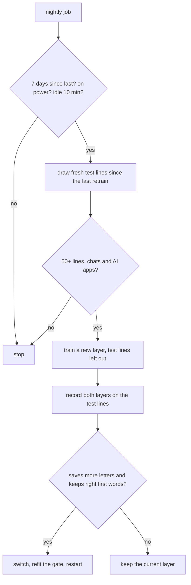

# Training

Drafter can learn how you write. It trains a small personal layer on your own lines, on your Mac, and keeps a new
layer only when it types better than the old one. Nothing in this page sends text anywhere.

## The personal layer

The base model is Qwen3 1.7B in 4-bit MLX. The personal layer is a LoRA adapter: a few small weight matrices
trained on your writing and added to 16 layers of the model.

- `bench/train.py` trains it with `mlx_lm.lora` and writes `data/adapters/`. It runs under the memory guard
  (`DRAFTER_TRAIN_CAP_GB`, default 6 GB).
- The engine merges the layer into the model in memory for typing (`DRAFTER_LORA_FUSE`, default 1).
  /health reports `lora_merged`.
- Chips and rewrites switch the layer off for that call. A model trained on chat lines follows instructions less
  well.

## The corpus

`bench/corpus.py` builds your writing into one dated file, `data/corpus.jsonl`, with counts per source in
`data/corpus-counts.json`. Phrase memory, the word finisher and the training lines all read it.

| Source | What it is |
|---|---|
| `typed` | Lines you sent with Return while Drafter was on (`data/typed.jsonl`) |
| `take` | Your voice takes, the cleaned text |
| `cc`, `codex` | Your own prompts in coding-agent sessions |
| `beeper` | Messages you sent, through the optional Beeper integration |
| `vnotes` | Takes from the optional Voice Notes app |
| `vault` | Notes you wrote yourself in an optional notes folder |
| `fb` | Posts from an optional social media export (`social.facebook_archive` in the local config) |

The first source wins a duplicate. The filters drop:

- pasted text, code, stack traces, logs, diffs, tags and JSON;
- lines over 600 characters, lines of fewer than 3 words, text over 6 lines;
- agent wrappers and lines signed by an agent;
- anything matching a recent clipboard text;
- any line in Russian.

A typed line that matches a take is marked as dictated. `bench/make_train.py --corpus data/corpus.jsonl` turns the
corpus into training lines, with a weight per source (`corpus.WEIGHTS`). Typed lines count twice; notes and posts
count half; chat messages count a tenth, so they do not drown the prompts; voice takes are left out (they add fillers).

## The weekly retrain



`bench/retrain.py` does the work. The rules a new layer must meet:

- Both layers are tested on fresh lines that neither has seen. `bench/make_fresh.py` draws them from what you
  wrote since the last retrain, and `bench/make_train.py` leaves them out of training.
- Each layer is recorded the way Drafter types (`bench/typebench.py`, with the booster) and scored through the
  gate on held-out folds (`gate.summary`).
- The new layer wins only when letters saved over both app kinds go up by more than 0.5 points, and neither
  app kind's share of right first words falls by more than 2 points.
- On a switch, the old layer moves to `data/adapters-prev/` and the gate is refit on the new layer's recording.
- Fewer than 50 fresh lines, or a set without both chat and AI-app lines, means no retrain that time.

`.venv/bin/python bench/retrain.py --compare data/adapters data/adapters-prev` runs the test alone and moves nothing.
Each run writes a report to `data/review/`.

## Train on your own writing

Run this from the repo root:

```sh
scripts/train.sh            # --check: only say whether there is enough text
```

It builds the corpus from the sources your local config allows (`data/drafter.local.json`, see
[Privacy](privacy.md)). It stops with a clear message when there is too little text to train on (about 2000 lines).
The first time, it trains a layer into `data/adapters`. When a layer exists, it runs the retrain above, which keeps
the new layer only if it does better. That comparison needs chat and AI-app lines in your newest text; without
them, `scripts/train.sh --new` trains a new layer and keeps the old one in `data/adapters-prev`.

Before you start:

1. Use Drafter for a while with "Learn from what I send" on, so `data/typed.jsonl` grows.
2. Turn on the optional sources you want in the local config. Each is off by default.
3. Quit Drafter and keep the Mac on power. Training takes 15 to 40 minutes. Open Drafter again to use the layer.

## What did not work

These tries are worth knowing before you repeat them. The numbers are from one user's writing, as an example.

- **A smaller model.** Qwen3 0.6B with a layer answered faster (about 21 ms to the first word against 32 ms). It
  lost 4-6 points of right first words. Speed did not make up for that.
- **A bigger model.** Qwen3 4B with a layer gained about one point of right first words. Merged, it went over the
  memory guard. Unmerged, it was over 60 ms at p90. Gemma models read Ukrainian chats well, but their
  sliding-window cache cannot be cut back. Every key then reads the whole prompt again, at 100-280 ms.
- **More sources for the layer.** A layer trained on every source was right a little more often and saved a point
  in chats. It lost 1-2 points of letters in AI apps, where most typing happened. Voice takes added spoken fillers
  and cost right first words. Prompts were the useful part.
- **Wider phrase memory.** A looser rule spoke three times as often but was right only about as often as the
  model. Letters saved moved by 0.2 points.

What did help: the screen text above the field (about 7 points of letters saved) and more sources for the word
finisher, which is not the layer.
