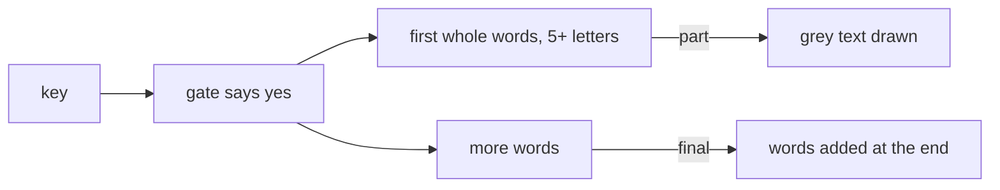

# Typing

Drafter shows grey text at the caret: its guess at what you type next. Tab takes it one word at a time. This page
explains where a guess comes from and when Drafter shows it. [Architecture](architecture.md) shows the path from
key to screen.

## Three sources of a suggestion

| Source | Code | Speed | What it does |
|---|---|---|---|
| Phrase memory | `engine/memory.py` | about 1 ms | Speaks when your last 2-5 words (8+ letters) repeat a line you wrote before and that line has one clear continuation |
| Word finisher | `engine/words.py` | under 1 ms | Finishes the word you are typing from your own writing: it looks at two words back, then one, then the word alone, and needs 2+ uses and a 60% share |
| The model | `engine/model.py` | tens of ms | A small local model (Qwen3 1.7B, 4-bit, MLX) with your personal layer, reading the text before the caret and the screen text above the field |

The word finisher also does two more jobs:

- **Booster.** While the model writes the first word, your own likely next words are mixed into its guess, token
  by token. `Words.dist` gives them with shares. `Model.booster` mixes them in at the share named `boost` in
  `data/gate.json`.
- **Fix.** When the word you type is no word you write but a frequent word of yours is one letter away, or is the
  same keys in the other keyboard layout, the ghost reads "→ word". This is `Words.fix`.

The model keeps a fixed prompt head (`engine/prompt.py`) in its cache. It heals a half-typed word: it re-reads
the letters you typed as given, then guesses the rest. Each new request stops the older one at the next token.

## The gate

A guess the model is unsure of costs you a look. The gate decides whether to show it at all.

- `engine/gatecore.py` is a small logistic model over 15 numbers: first-word probability, the margin to the next
  choice, mid-word or not, app kind, script, whether the word finisher agrees, and more (`gatecore.NAMES`).
- It decides once the first word is whole. Sure words may follow it.
- `bench/gate.py <recording> --save` fits it on a recording made by `bench/typebench.py` and writes
  `data/gate.json`. The gate is specific to one model and layer, so refit it after a retrain.
- With no `data/gate.json`, the engine falls back to fixed probability bars and at most 3 words.
- When the gate says no, the word finisher may still finish the word you are typing.

## The selector

`bench/selector.py` fits one calibrated model over all three sources (`gatecore.SEL_NAMES`). Phrase memory and
your own word answer at once when their chance clears one bar. Otherwise the model's first word must clear the same
bar (`server.offers_now`). It is off until `data/selector.json` exists. As an example, on one user's writing a bar
of 0.65 cut wrong ghosts by about a third and kept about nine tenths of the letters saved.

A related gate, `bench/wordgate.py`, decides when your own finish of the current word shows first. The model then
only extends it (`server.word_first`). It is off until `data/wordgate.json` exists.

## Why guesses under 5 letters are hidden

A short word is as quick to type as to Tab. In one user's logs, ghosts under 5 letters were taken with Tab about
3% of the time and ghosts of 5-9 letters about 29%. So the app sends `min_letters` (setting `minGhost`, default 5)
and every source obeys it.

Hiding alone loses letters. So a short guess grows: the engine goes on past its sure words while each token stays
at or above 0.05 (`DRAFTER_GROW`), up to 6 words (`DRAFTER_GROW_WORDS`). What is still short is not shown.

## The two-step ghost

The engine calls `on_part` in `model.complete_gated` as soon as the gate says yes and whole words of 5+ letters
exist. A word still being spelled is never sent (`gatecore.whole_words`). With `"stream": true`, /complete
answers one JSON line per part, then the final answer. The app draws the first part at once and later lines only
add words at the end (`Ghost.extend`), so shown words never move. `GhostRules.next` in `app/GhostRules.swift`
decides what a later line does. The setting is `streamGhost`, on by default.

## The kept distribution

Inside a half word, the prompt stays the same from key to key, because typed letters are healed, not fed.
`Model._steps` keeps the raw next-token logits beside the cache. `Model._reuse` takes the first token from them
with no forward pass. On a test of about 1,000 keys this gave the same choices and saved about 6 ms on most keys.
It is on by default. `DRAFTER_DIST=0` turns it off.

## The prepared branches

After each answer, `server.look_ahead` works in the gap before your next key:

1. The answer for when you take the ghost, so Tab, Tab, Tab never waits for the model.
2. The answers for the next letter of two word branches (`server.branch_letters`): the model's own next word and
   your likely next word.

Each is kept for 30 s under the exact request (`server.ahead_key`). A hit costs 1-2 ms. A newer key stops this
work at the next token. `DRAFTER_BRANCHES=0` turns the branches off. The cost is up to two extra model runs per
key while you type.

## Tab and other keys

- **Tab** takes the next word of the ghost and its space. When it takes the last word, the next answer is often
  ready already.
- **⇧Tab** takes the whole ghost.
- **Tab on a chip** runs the chip: a snippet, a fact, a translation, an action. Chip marks are in [Look](look.md).
- **Tab on "→ word"** puts the fix in. Backspace as the very next key brings your letters back.
- **Typing the same letters** as the ghost keeps it. Nothing jumps.
- **Any other key** drops the ghost and goes to the app. Esc and shortcuts are never taken.
- `GhostRules.tabStillValid` makes sure a fast second Tab never puts the same word in twice.

`Keys.handle` in `app/Keys.swift` holds all of these rules.

## Measuring a change

Every typing bench scores through one replay, `bench/measure.py`: first word right at first display, letters
saved, wrong first words per 1,000 letters, and time to the first grey text. It uses held-out lines with a dated
split. [Contributing](contributing.md) asks for these numbers before and after any typing change.
