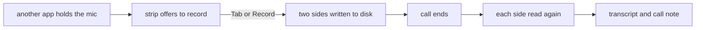

# Voice and calls

Drafter takes dictation on the Right Option key, once on (menu: Voice on Right Option; off on a new Mac, so ⌥ characters
stay), and records calls and long notes. All speech is read on your Mac
by local models in `engine/voice.py`. [Architecture](architecture.md) shows how the voice process fits in.

## Takes

A take is one stretch of dictation.

| Key | What it does |
|---|---|
| Right Option | Starts a take. Press again to end it. |
| Hold Right Option | Push to talk: the take ends when you let go. |
| Esc | Drops a short take. It never drops a long note or a call. |
| ↵ | During a take: puts the words heard so far into the field, without sending; listening goes on. After it: puts the take in. |
| ⇧ Right Option | Starts a recording: a long note, or records a call when another app holds the microphone (it also takes the strip's call offer; Tab never does). |
| Right Option twice | The last take again at the caret (`againTap`). |
| A key while Right Option is held | Before any words: the take is dropped and the key goes to the app (⌥ characters). |

- When a take ends, its words wait in the strip, and ↵ puts them in at the caret (`voiceInsert` "enter", the
  default; "live" types the words into the field as you speak). Any other key, or 45 s, leaves the take in the
  window; Right Option twice puts it in later. With no text field in focus, it goes to the clipboard.
- A take ends by itself after 45 s with no new words.
- `app/Rules.swift` handles spoken corrections ("no wait", "scratch that"), spoken lists and closing words.
- Select text, then talk: your words replace the selection, or an instruction rewrites it. A rewrite may use the
  connected model only when the `rework` switch is on (see [Privacy](privacy.md)).
- Every take is kept in `data/takes.jsonl`, with its recording in `data/audio/` for 14 days. When rules changed a
  take, the text as heard is kept too, as `raw`.

## The strip

The strip (`app/Pill.swift`) hangs from the notch, or floats under the menu bar on a screen without one. It shows
the words heard so far. Words that two drafts agree on stay put. Only the newest words change. Nothing is typed
into the field while you talk. A take that lands shows a check mark. During a long note or a call, the strip shows
the time, levels for both sides and a live outline.

## The two readers

Only one speech model is loaded at a time. The voice process runs under its own memory guard (2.8 GB).

| Reader | Role | When |
|---|---|---|
| Parakeet | Fast. Live drafts while you talk and the final text of most takes | Loaded when voice is on, kept for 4 hours without a take (`DRAFTER_VOICE_IDLE`) |
| Whisper | Careful. A second pass over loud takes and a fallback for whole recordings | Loaded for the pass, then dropped; Parakeet loads back at once |

- `engine/voice_language.py` (`fast_language`) locks a take to Ukrainian or English when more than 60% of its
  letters are in one script. Otherwise the reader detects the language.
- A stretch with almost no sound is not read at all (`has_speech`). Readers tend to invent words like "Okay." in
  silence.
- A careful result that loses more than half the words of the fast one is not used.
- Names from your dictionary (`data/words.json`) go into Whisper's prompt as a hint.

## Recording a call

1. When another app holds the microphone and a call app runs, the strip offers to record for 30 s. Tab or Record
   starts it. Drafter never starts a recording by itself. Esc lets the offer go. ⇧Esc turns offers off for that app.
2. Your microphone and the Mac's own sound (the other side, through ScreenCaptureKit) are kept apart. `Tape` in
   `app/Call.swift` writes `me.pcm` and `them.pcm` on the microphone's capture queue, so a busy main thread cannot
   stop the files growing. When call audio is missing, it writes silence, so both sides keep one timeline.
3. A call ends on ⇧ Right Option, when the call app quits, or when the app lets go of the mic and nobody speaks.
4. At the end, both sides become WAV files in `data/calls/<time>/`. Each side is read again in full
   (`read_file` in `engine/voice.py`). Your lines that echo the other side are dropped (`Transcript.echoless`).
5. A closed recording carries an `.unread` marker until `transcript.txt` is written. On the next start,
   `Spool.recover` reads a marked folder again, at most twice.

A long note works the same way with one side only.

## Side warnings

While a recording runs, the strip says when a side is not heard. `CallHealth.warning` in
`app/CaptureRules.swift` decides the line. Examples: the microphone gives no sound, the microphone is muted, call
audio did not start, or no sound comes from the other side. Before this, a call could end with nothing on either
side and no warning.

## Call notes

`engine/notes.py` turns a recording into a note in `data/notes/`: a title, a summary and a To do list.

- The live outline in the strip is rebuilt every 75 s from everything said so far.
- The outline and the final summary use the connected model (its fast model) only when the `callNotes` switch is on
  and the Mac is online. Off, the local text model writes them. Only the transcript text is sent, never audio.
- With the `shots` setting on (off by default; Settings: "Screenshots while recording"), `app/Shots.swift` keeps
  screenshots in the recording's shots folder, on this Mac only. It takes one when the screen changes and then stands
  still. `app/Transcript.swift` writes `brief.md`: what was said in time order, with each screenshot where it was
  taken. You can hand that file to a coding agent.
- **Screen video while recording** in Settings > Calls is off by default (`callScreenVideo`). It saves local
  `screen.mp4` for Call Studio, at most one changed frame per second and a still frame every five seconds.
  Capture skips paused calls, excluded apps, secure input, and locked or sleeping displays. Drafter windows stay hidden.
  Video uses the recorded audio clock, even dimensions up to 1280 pixels wide, and H.264 at a target 500 kbps.
  It stops before 250 MB or at four hours; audio continues. Only a finalized video becomes available for replay.
- Call Studio shows video duration and an end marker when audio runs longer. Dragging the timeline pauses playback;
  release seeks both tracks and resumes only when playback was active.
- The Calls & notes page in the window (`app/Recordings.swift`) lists every recording, searches all of them and
  has Read again (⌘R).
